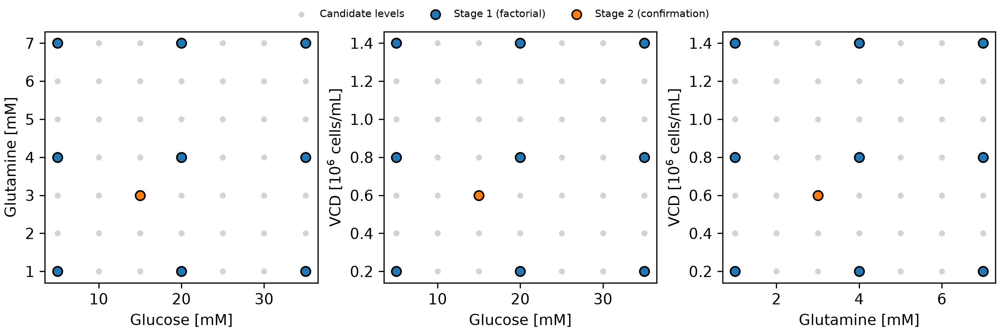
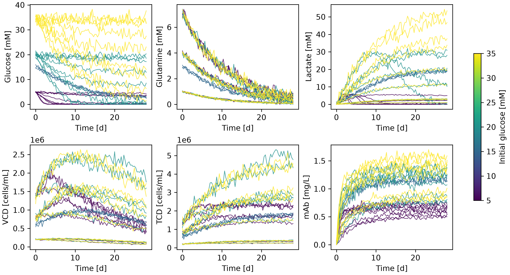
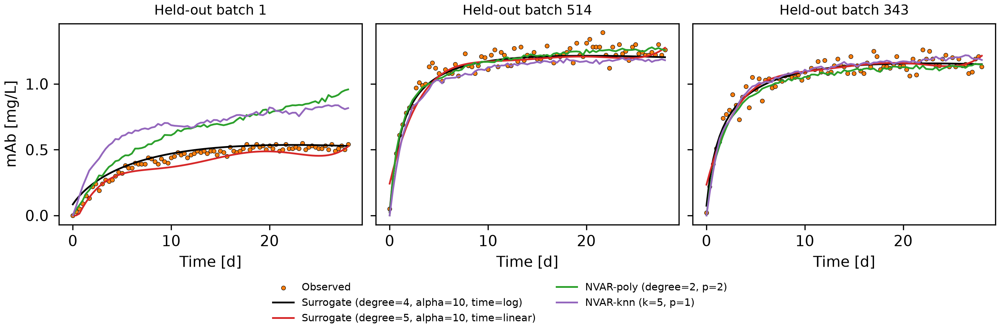
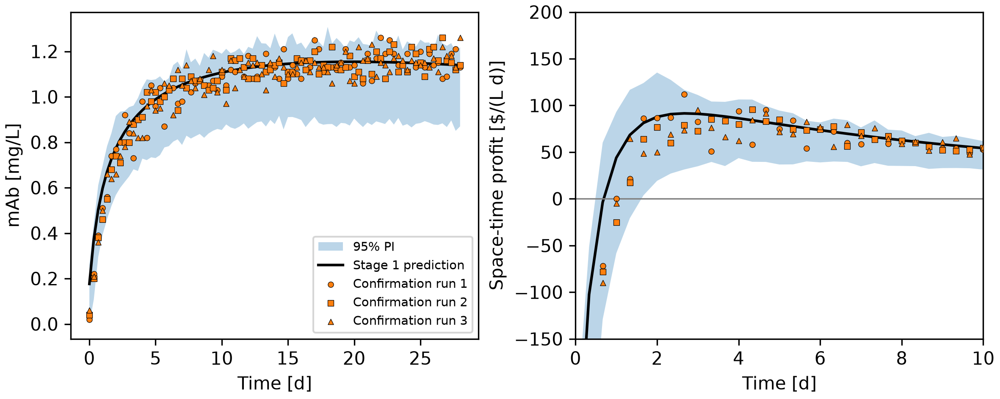
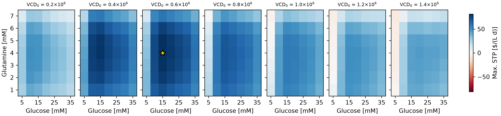
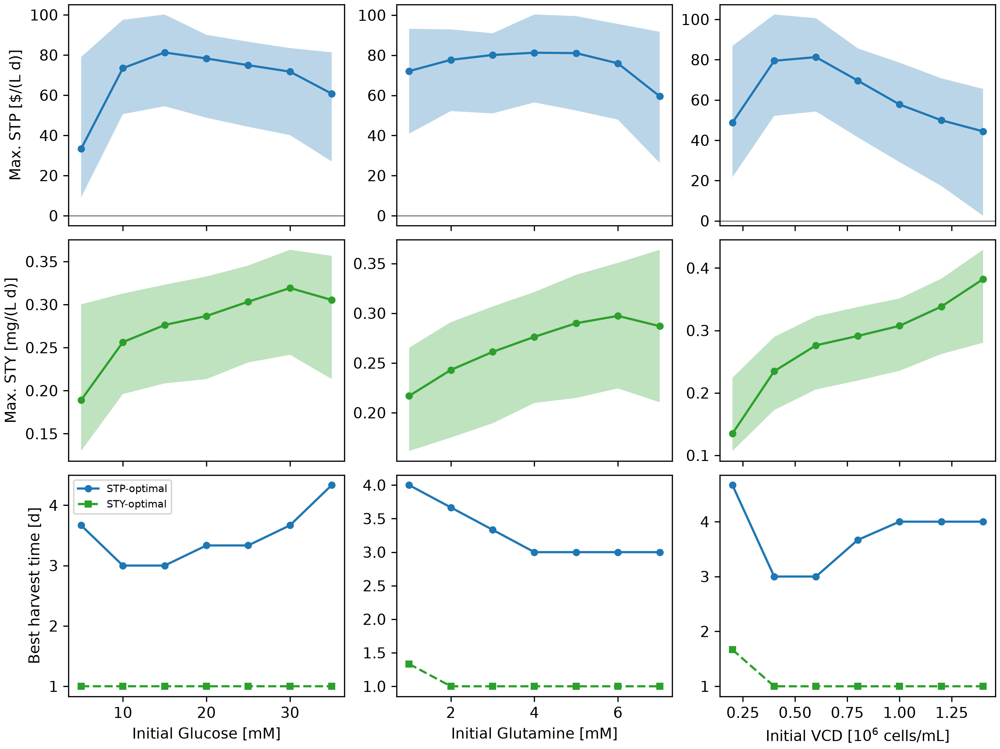
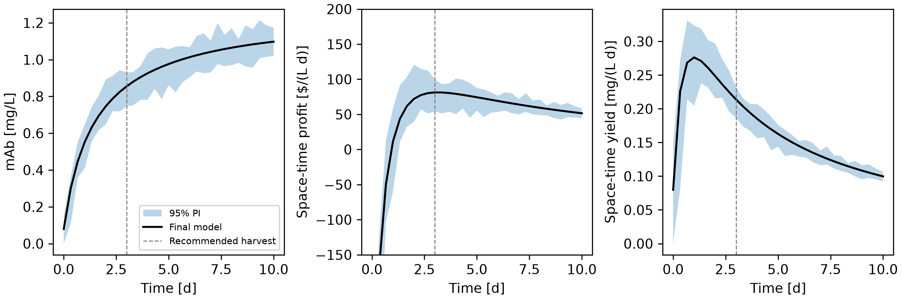

# mAb Production Optimization

This project identifies the batch recipe that maximizes the space-time profit of monoclonal antibody (mAb) production in a 1 L bioreactor. Using only 30 batch runs selected through a two-stage experimental design, it builds a polynomial response surface that predicts the antibody titre curve from the initial glucose, glutamine and cell density. It estimates uncertainty with a batch-level bootstrap and searches 343 candidate recipes, at every possible harvest time, for the most profitable option.
## Highlights

- Designed a sequential, two-stage experiment (3 × 3 × 3 factorial plus three confirmation replicates) that used only 30 of 1029 available batch runs.
- Developed a direct polynomial surrogate of the mAb titre that cut leave-one-batch-out error by roughly 50% compared
- Quantified prediction uncertainty with a batch-level bootstrap and validated it, reaching 93–94% empirical coverage of
  the nominal 95% prediction intervals.
- Optimized initial conditions and harvest time over 29,155 recipe/harvest combinations, identifying an operating point
  worth 81 $/(L·d).
- Validated the model prospectively: confirmation runs placed at the predicted optimum landed inside the predicted
  95% intervals.

## Environment

- Python 3.14.7
- matplotlib 3.11.0
- NumPy 2.5.2
- pandas 3.0.5
- scikit-learn 1.9.0

## Code Design

When you run the `main.py` program and call it, it will execute pretty much all the work from reading raw data from CSV files to making all the suggestions in the document. The `main.py` serves only as a conductor for events. All the business logic is situated in the folder `src/`. The file `src/constants.py` shows the assumptions like file paths, parameters of the economy, candidate levels, the design of the experiment, hyperparameter grids, and random seed. The file `src/classes.py` provides two experience models, while the file `src/functions.py` provides everything related to data processing.

### 1. Data loading and experimental design

In order to read the `initial_conditions.csv` file, the program has to check and gather all the `batch_####.csv` files from the folder called `datasets`. Since the batch files are checked automatically, any additions or deletions of runs do not require any changes in the code. Every batch is read in a three-dimensional array format (batch × time × variable process), and the whole process is checked against an 8 hours long sampling schedule that enables all the steps of the program to allow for vector economics. After that, each experiment gets a label as either belonging to either the Stage 1 factorial or Stage 2 confirmation runs and the parameters describing economic results (that is cost, peak titres and best harvest) are recorded in the relevant tables. The given stage is necessary for ensuring the right work of all these stages of the program on the validated and properly standardized dataset.

### 2. Model selection

This stage decides which model is trusted for optimization. Two families are compared. The first is a direct
surrogate (`PolynomialSurrogate`) that maps the three initial conditions and time to the mAb titre in one step. Its
feature engineering expresses VCD in millions of cells/mL to keep polynomial terms well conditioned, optionally
replaces time with log(1 + t), standardizes the inputs, expands them into polynomial terms and fits a ridge
regression. The second family is NVAR (`NVARModel`), which learns how all seven process variables change over one
sampling interval from the previous *p* states and builds a full trajectory by feeding its predictions back into
itself, adding re-sampled training residuals as white noise.

**Each specific configuration (32 surrogate configurations and 6 NVAR configurations) is validated through the leave-one-batch-out cross-validation process adapted to our particular task.
It is important to leave out an entire batch, not just certain points in time, because points from the same batch are highly correlated; doing random sampling will lead to information leakage and overestimating performance. The held-out batch is forecasted using only predetermined initial conditions, which is how we use these models for making predictions in practice later on. The models are compared based on the error made in the first ten days, as this is the time of all significant harvests.**

### 3. Prospective validation of the design

The model is refit on the 27 Stage 1 batches only, reproducing the information that was available when the
confirmation runs were planned. Its prediction and 95% prediction interval at the Stage 2 recipe are compared with the
three confirmation runs. This stage exists because cross-validation alone cannot show whether the optimizer's choice
holds up when tested, and an optimum is the place where models are most often over-optimistic (Table 4, Figure 4).

### 4. Uncertainty quantification and calibration

Prediction intervals come from a batch-level bootstrap. Batches are resampled with replacement and the surrogate is
refit, which captures model uncertainty; a training residual observed at the same time point is then added, which
captures run-to-run and measurement noise. Drawing residuals by time point respects the fact that noise grows as the
titre rises. To check that these intervals are honest, the whole procedure is repeated inside leave-one-batch-out
cross-validation and the fraction of held-out measurements falling inside their interval is reported (Table 5). This
stage is what allows the final recommendation to be reported with defensible 95% intervals instead of a single number.

### 5. Optimization and reporting

The final model was assessed based on all thirty batches, and predictions for the titre curves associated with the 343 potential recipes (seven assumptions about each initial condition) were made. The cost, value, space-time profit and space-time yield were calculated for every one of the total 85 harvest times; the optimizer thus actually chooses the recipe and the harvest time in the course of the optimization procedure. Recipes were ranked in terms of space-time profit metric and separately for space-time yield (Table 6, 7). Bootstrap prediction intervals were then calculated for the above optimal recipes and conditions in terms of the variance—one factor at a time (Table 8, 9, Figure 5-7). The final step converts the model into the proper recipe and harvest schedule that project was destined for.

## Analysis

### Choice of the 30 batch runs

The 30 runs were spent in two stages rather than all at once, a standard sequential strategy for response-surface
optimization.

**Stage 1 (27 runs): a complete factorial design of 3 × 3 × 3.** The test commenced with each of the three factors tested at low, middle, and high levels: glucose at 5, 20, and 35 mM; glutamine at 1, 4, and 7 mM; and viable cell density (VCD) at 0.2, 0.8, or 1.4 million cells/mL (see Figure 1). The design possesses three characteristics that are significant in the current context. The first characteristic is that the entire candidate range is covered, which ensures that rather than extrapolation, interpolation is used at the last stage of optimization. The second characteristic is that the number of levels per factor is the smallest number of levels required for the curvature estimation. This fact was expected because too little glucose or glutamine will cause the culture starvation in one case, and too much, in another case, will incur additional costs and by-products. The third characteristic is that the design is both balanced and orthogonal, which allows separating both the main influences and interactions of two factors. Only one replicate was run per condition, because each time series already contains 85 readings per run, which limits noise, and because testing new conditions was more informative than repeating corners of the design space.

**Stage 2 (3 runs): confirmation replicates.** A surrogate using data from Stage 1 determined that the most effective recipe was 15 mM glucose, 3 mM glutamine and 0.6 x 10⁶ cells/mL, which is in a central position between factorial levels where the model was least limited. All three replicates of this recipe were conducted. These tests have 3 purposes: they allow testing of the prediction at the levels where it matters most, they provide information right where the optimum situation lies, and they show variability of the method from run to run.

The raw data already show the trade-off that the optimization must resolve (Figure 2, Table 1). Most of the titre is
produced in the first 3–5 days, after which it plateaus while VCD declines. High VCD and high glucose give the highest
titres (up to ~1.7 mg/L) but are expensive, and low-glucose cultures exhaust glucose within a few days and plateau
around 0.5–0.8 mg/L.

### Model architecture and hyperparameters

Two model families were compared with leave-one-batch-out cross-validation (Table 3, Figure 3).

| Model                   | Best configuration                    | LOBO RMSE, full run [mg/L] | LOBO RMSE, first 10 d [mg/L] |
|-------------------------|---------------------------------------|----------------------------|------------------------------|
| Surrogate (log time)    | degree = 4, α = 10, time = log(1 + t) | 0.048                      | 0.050                        |
| Surrogate (linear time) | degree = 5, α = 10, time = t          | 0.065                      | 0.074                        |
| NVAR-poly               | degree = 2, p = 2                     | 0.133                      | 0.096                        |
| NVAR-kNN                | k = 5, p = 1                          | 0.159                      | 0.160                        |

**Selected model: direct polynomial surrogate.** The model predicts mAb [mg/L] from initial glucose, initial
glutamine, initial VCD and log(1 + t), using standardized inputs, polynomial terms up to degree 4 and ridge regression
with α = 10. Each choice was justified by the data:

- *Direct rather than recursive.* The economic objective depends only on the titre, and the titre at any time is a
  smooth function of the initial conditions. A direct model predicts that quantity in one step, so errors cannot
  accumulate over 85 recursive steps.
- *log(1 + t) time feature.* Titre curves rise quickly and then plateau. The logarithm turns this shape into a nearly
  polynomial one, reducing the harvest-window error from 0.074 to 0.050 mg/L.
- *Degree 4.* Degrees 2 to 5 were tested. Degree 2 underfits (0.089 mg/L) because it cannot bend the curve and model
  interactions at the same time, while degree 5 begins to overfit (0.055 mg/L).
- *Ridge with α = 10.* With only three levels per factor in Stage 1, some high-order terms are nearly collinear (for
  example, the cubic and linear terms of a factor coincide on three equally spaced points). A small penalty stabilizes
  those coefficients. Much larger penalties (α = 100) underfit.

The selected model's error of 0.050 mg/L is close to the scatter of the measurements themselves (in-sample residual
≈ 0.044 mg/L), so little systematic error remains to remove.

**Comparison with NVAR.** NVAR was the natural alternative because it models the full process dynamics and can, in
principle, capture mechanisms such as nutrient depletion. In practice, it performed two to three times worse. Its
predictions are fed back into the model, so small errors in glucose or VCD compound into large errors in the titre;
batch 1 in Figure 3 is a clear example in which both NVAR variants drift upward while the surrogate tracks the data.
The k-NN version is also limited by having only 27–30 trajectories to borrow neighbours from.

**Advantages and limitations.** The surrogate is fast (one fit takes milliseconds, which makes a 1000-sample
bootstrap practical), it is smooth, so the optimizer is not misled by noise, and its predictions are directly
validated on held-out batches. Its limitations are that it is purely empirical and should not be trusted outside the
tested ranges, it describes only the titre and not the cell physiology, and between the Stage 1 levels its shape is
partly governed by the regularization. This last limitation is precisely why the confirmation runs were placed in the
interior of the design space.

### Validation of predictions and uncertainty

The Stage 1 model, before seeing any Stage 2 data, predicted 0.845 mg/L at 64 h (95% PI 0.625–0.938 mg/L) for the
confirmation recipe. The three confirmation runs measured 0.92, 0.80 and 0.78 mg/L at that time, all inside the
interval, and 100% of their measurements in the first 10 days fell within the predicted band (Figure 4).

| Batch | Predicted mAb at 64 h [mg/L] | Observed mAb [mg/L] | Predicted STP [$/(L·d)] | Observed STP [$/(L·d)] |
|-------|------------------------------|---------------------|-------------------------|------------------------|
| 343   | 0.845 (0.625–0.938)          | 0.92                | 91.5                    | 111.8                  |
| 344   | 0.845 (0.625–0.938)          | 0.80                | 91.5                    | 79.1                   |
| 345   | 0.845 (0.625–0.938)          | 0.78                | 91.5                    | 73.6                   |

The average recorded profit of ($88.2/(L·day)) differs by 4% as compared to the forecasted value, while the difference between
the results of several experiments (from $74 to $112/(L·day)) indicates how strongly the outcome of a single experiment can differ
from the one of another. The bootstrapping technique used for leave-one-batch-out cross-validation produced 92.8% of the test results and 93.7% of the results obtained
within the first 10 days falling into the forecasted 95% prediction intervals.

### Influence of initial conditions on space-time profit and yield

Figures 5 and 6 present the maximal possible values of space-time profit and the profits obtained by changing one parameter
each time and adjusting the harvesting time accordingly.

- When it comes to **initial glucose**, it is considerably influential at lower concentrations and is quickly exhausted at about 5 mM. That's why, only a low mAb titre is produced at that initial concentration, resulting in profit being equal to 33 $/(L·d). Profit is the highest at the concentration of 15 mM and then continues declining at slower rates because of high costs of additional millimolar glucose (10 $/L) and the small gain in titre.. Space-time yield increases all the way to 30 mM because yield is not connected to the costs.
- **Initial glutamine** produces a flat optimum between 3 and 5 mM (80–81 $/(L·d)). Below this range, growth is
  limited; above it, profit drops (59 $/(L·d) at 7 mM) because glutamine is the most expensive nutrient per millimolar
  and its breakdown releases growth-inhibiting ammonia.
- **Initial VCD** has an optimal value of 0.4 to 0.6 × 10⁶ cells/mL. At low inoculum levels, titres take more time to build up, while high inoculum levels increase yield up to 0.38 mg/(L·d) but cost 0.0005 $/L per cell/mL of inoculum, making the profit drop to 44 $/(L·d) at 1.4 × 10⁶ cells/mL.- **The harvesting time** has proved to be an important decision due to the negative profit margin when harvesting takes place within the first day and subsequently rapid growth in profits, peaking at around 3 days, and gradual decrease in profit margin that occurs when the titre level stabilizes at a certain position while occupying the batch. The maximum yield is reached even earlier, at about 1 day, because one day of downtime is charged to every batch whatever its length.

  
The primary conclusion is that **profit and yield favour different recipes**. The yield-maximizing recipe (35 mM glucose, 6 mM glutamine, 1.4×10⁶ cells/mL, harvested at 24 hours) increases the yield to 0.43 mg/(L·d), which leads to a loss of 151 $/(L·d) due to the 1170 $/L cost of medium, leaving only 0.6% chance of being profitable (Table 8). Thus, aiming for maximum titre or productivity alone would be an expensive error.

### Recommended operating point

The model optimum over the 343 recipes and 85 harvest times is:

| Quantity                                  | Recommendation | 95% prediction interval |
|-------------------------------------------|----------------|-------------------------|
| Initial glucose [mM]                      | 15             | –                       |
| Initial glutamine [mM]                    | 4              | –                       |
| Initial viable cell density [cells/mL]    | 6.0 × 10⁵      | –                       |
| Harvest time [d]                          | 3.0 (72 h)     | –                       |
| Cell culture cost [$/L]                   | 530            | –                       |
| Cell culture value at harvest [$/L]       | 855            | 747 – 929               |
| Space-time profit [$ / (L·d)]             | 81.3           | 54.1 – 99.8             |
| mAb space-time yield [mg / (L·d)]         | 0.214          | 0.187 – 0.232           |

The bootstrap samples yielded positive results in profit. The optimum level lies in a wide plateau (see Table 6): either 5 mM of glutamine (81.1 $/(L·d)) or the 3 mM recipe confirmed in experiments after 80 hours of harvesting (80.1 $/(L·d)) are practically indistinguishable since there is a much smaller difference between them than ±25 $/(L·d) of the prediction interval. The practical importance of this statement lies in that in case a recipe is needed based on the data from physical replications, the recipe containing 15 mM of glucose, 3 mM of glutamine, and 0.6 × 10⁶ cells/mL is equally good and cheaper. The lessons learned are to use 15 mM of glucose, 3 to 5 mM of glutamine, and 0.4 to 0.6 × 10⁶ cells/mL of inoculum and to harvest somewhere in three days rather than carry on with the batch.
